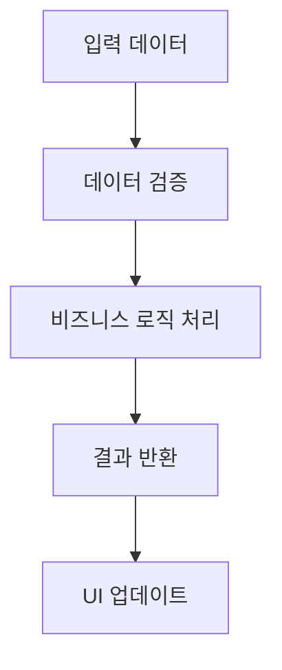

# 📋 Work Detail Report - {{date:YYYY-MM-DD}}

> [!info] **작업 개요**  
> **프로젝트**: [프로젝트명]  
> **담당자**: [이름]  
> **작업기간**: {{date:YYYY-MM-DD}} ~ [완료일]  
> **우선순위**: 🔥 높음 / 🟡 보통 / 🟢 낮음  
> **상태**: 🔄 진행중 / ✅ 완료 / 🔴 대기

---

## 🎯 작업 목표 & 요구사항

### 📌 주요 목표
- **핵심 목표**: [주요 목적]
- **기대 효과**: [예상 결과]
- **성공 지표**: [측정 가능한 기준]

### 📋 상세 요구사항
> [!note] **Requirements**
> 
> **기능적 요구사항**:
> - [ ] [요구사항 1]
> - [ ] [요구사항 2]
> - [ ] [요구사항 3]
> 
> **비기능적 요구사항**:
> - [ ] [성능 요구사항]
> - [ ] [보안 요구사항]
> - [ ] [사용성 요구사항]

---

## 🏗️ 아키텍처 & 설계

### 🎨 시스템 설계
> [!abstract] **Architecture Overview**
> 
> **컴포넌트 구조**:
> ```
> [시스템 구조도 또는 설명]
> ```
> 
> **데이터 플로우**:
> 1. [데이터 입력]
> 2. [처리 과정]
> 3. [데이터 출력]

### 🔧 기술 스택
| 분야 | 기술 | 버전 | 사유 |
|------|------|------|------|
| **Frontend** | | | |
| **Backend** | | | |
| **Database** | | | |
| **Infrastructure** | | | |

---

## 💻 구현 상세 내용

### 📂 작업 항목별 상세

#### 🔸 [작업 항목 1]
> [!code] **Implementation Details**
> 
> **📁 관련 파일**: `파일경로:라인번호`
> 
> **🎯 구현 목적**:
> - [목적 설명]
> 
> **⚙️ 구현 로직**:
> ```typescript
> // 핵심 로직 코드
> const exampleFunction = () => {
>   // 구현 내용
> };
> ```
> 
> **🔧 핵심 포인트**:
> - [중요한 구현 사항]
> - [주의사항]
> - [최적화 포인트]

#### 🔸 [작업 항목 2]
> [!code] **Implementation Details**
> 
> **📁 관련 파일**: `파일경로:라인번호`
> 
> **🎯 구현 목적**:
> - [목적 설명]
> 
> **⚙️ 구현 로직**:
> ```typescript
> // 핵심 로직 코드
> ```
> 
> **🔧 핵심 포인트**:
> - [중요한 구현 사항]

---

## 🧠 로직 분석 & 알고리즘

### 🔍 핵심 로직 분석

#### 📊 알고리즘 상세
> [!tip] **Algorithm Analysis**
> 
> **알고리즘 선택 이유**:
> - [선택 근거]
> 
> **시간 복잡도**: O(n)
> **공간 복잡도**: O(1)
> 
> **최적화 방법**:
> - [최적화 기법]
> - [성능 개선 포인트]

#### 🔄 데이터 처리 플로우


### 🎛️ 상태 관리 패턴
> [!gear] **State Management**
> 
> **상태 구조**:
> ```typescript
> interface State {
>   // 상태 정의
> }
> ```
> 
> **상태 업데이트 로직**:
> - [업데이트 패턴]
> - [부수 효과 관리]

---

## ⚡ 성능 최적화

### 📈 성능 개선사항
> [!performance] **Performance Improvements**
> 
> | 항목 | Before | After | 개선율 |
> |------|--------|-------|--------|
> | 응답시간 | ms | ms | % |
> | 메모리 사용량 | MB | MB | % |
> | CPU 사용률 | % | % | % |

### 🚀 최적화 기법
1. **렌더링 최적화**:
   - [최적화 방법]
   - [적용 결과]

2. **메모리 최적화**:
   - [최적화 방법]
   - [적용 결과]

3. **네트워크 최적화**:
   - [최적화 방법]
   - [적용 결과]

---

## 🧪 테스트 & 검증

### ✅ 테스트 계획
> [!test] **Testing Strategy**
> 
> **테스트 타입**:
> - [ ] Unit Test
> - [ ] Integration Test
> - [ ] E2E Test
> - [ ] Performance Test
> 
> **테스트 커버리지**: %

### 🔍 검증 결과
| 테스트 케이스 | 상태 | 결과 | 비고 |
|---------------|------|------|------|
| [테스트케이스 1] | ✅ Pass | | |
| [테스트케이스 2] | ✅ Pass | | |
| [테스트케이스 3] | ❌ Fail | | [수정 필요] |

---

## 📚 학습 내용 & 인사이트

### 💡 새로 학습한 기술
> [!learn] **New Learnings**
> 
> 1. **[기술/개념 1]**:
>    - [학습 내용]
>    - [적용 방법]
> 
> 2. **[기술/개념 2]**:
>    - [학습 내용]
>    - [적용 방법]

### 🔍 인사이트 & 깨달음
> [!insight] **Insights Gained**
> 
> **기술적 인사이트**:
> - [중요한 깨달음]
> 
> **프로세스 개선**:
> - [개선 아이디어]
> 
> **향후 적용점**:
> - [다음 프로젝트 적용 가능한 부분]

---

## 🚧 이슈 & 해결책

### ⚠️ 발생한 이슈들
> [!warning] **Issues Encountered**
> 
> 1. **[이슈 1]**:
>    - **문제**: [문제 상황]
>    - **해결**: [해결 방법]
>    - **학습**: [배운 점]
> 
> 2. **[이슈 2]**:
>    - **문제**: [문제 상황]
>    - **해결**: [해결 방법]
>    - **학습**: [배운 점]

### 🔧 개선 사항
- [ ] [개선점 1]
- [ ] [개선점 2]
- [ ] [개선점 3]

---

## 📈 작업 진행 현황

### 📊 진행률 체크리스트
- [ ] **요구사항 분석 완료** ✅ {{date:YYYY-MM-DD}}
- [ ] **설계 완료** 🔄 진행중
- [ ] **구현 완료** 📅 예정
- [ ] **테스트 완료** 📅 예정
- [ ] **배포 준비** 📅 예정
- [ ] **문서화 완료** 📅 예정

### 🕐 타임라인
| 날짜 | 활동 | 상태 | 소요시간 |
|------|------|------|----------|
| {{date:YYYY-MM-DD}} | 분석 시작 | ✅ 완료 | 2h |
| {{date:YYYY-MM-DD}} | 설계 작업 | 🔄 진행중 | 4h |
| {{date+1d:YYYY-MM-DD}} | 구현 시작 | 📅 예정 | 8h |

---

## 🔮 향후 계획

### 📋 다음 단계
> [!todo] **Next Steps**
> 
> **단기 계획** (1-2주):
> - [ ] [작업 1]
> - [ ] [작업 2]
> 
> **중기 계획** (1개월):
> - [ ] [작업 3]
> - [ ] [작업 4]
> 
> **장기 계획** (3개월):
> - [ ] [작업 5]

### 🚀 확장 가능성
- **기능 확장**: [확장 아이디어]
- **성능 개선**: [개선 여지]
- **기술 도입**: [새로운 기술 적용]

---

## 🔗 관련 자료 & 참고문서

### 📚 참고 문서
- [[관련 문서 1]]
- [[관련 문서 2]]
- [[기술 스펙 문서]]

### 🌐 외부 자료
- [참고 링크 1]()
- [참고 링크 2]()
- [공식 문서]()

### 💬 회의록 & 의사결정
- [[회의록 YYYY-MM-DD]]
- [[기술 검토 결과]]
- [[의사결정 사항]]

---

## 📊 작업 메타데이터

### 📈 작업 통계
- **총 작업 시간**: [시간]
- **코드 라인 수**: [라인]
- **수정된 파일 수**: [개수]
- **추가된 테스트 수**: [개수]

### 🏷️ 태그 & 분류
- **기술 스택**: #frontend #backend #api
- **작업 유형**: #feature #bugfix #optimization #refactoring
- **난이도**: #easy #medium #hard
- **우선순위**: #high #medium #low

---

### 📝 작업 요약
> [!summary] **Work Summary**
> 
> **완성한 것**:
> - [주요 성과 1]
> - [주요 성과 2]
> 
> **배운 것**:
> - [핵심 학습 내용]
> 
> **다음에 할 것**:
> - [다음 작업]

---

#work-detail #implementation #{{date:YYYY-MM-DD}} #development #coding

---

---
date: 2026-05-25
project: 부산 동선별, 목적별, 수단별 최적화 코스추천
source: javis
type: work-detail
tags:
  - javis
  - work-log
generated_by: codex
agents: HARU, REMI, IVY, MIMI, DORI, AEGIS
---
# 부산 동선별, 목적별, 수단별 최적화 코스추천 작업 상세 - 2026-05-25
## 요약
- 프로젝트 상태: ACTIVE
- 진행률: 0%
- 할당 에이전트: HARU(Planner), REMI(PM), IVY(UX Researcher), MIMI(Designer), DORI(Full-stack Developer), AEGIS(Security Architect)
- 작업 0건, 회의 2건, 리포트 0건, 오케스트레이션 0건을 기준으로 생성됨
