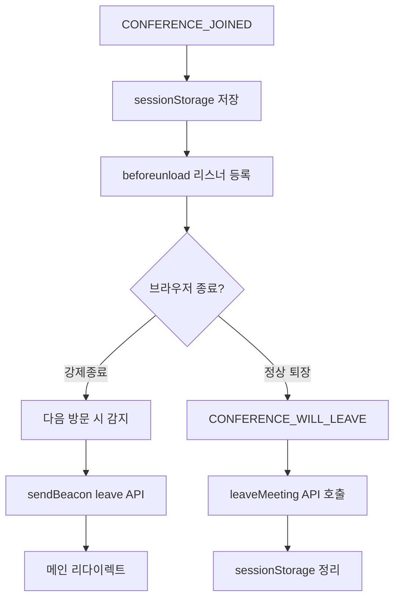

# 📋 Work Detail Report - KD Jitsi 플랫폼 Frontend 작업 - 2026-05-15 ~ 2026-06-10

> [!info] **작업 개요**  
> **프로젝트**: KD Jitsi 화상회의 플랫폼  
> **담당자**: 이인우  
> **작업기간**: 2026-05-15 ~ 2026-06-10  
> **우선순위**: 🔴 높음  
> **상태**: ✅ 완료

---

## 🎯 작업 목표 & 요구사항

### 📌 주요 목표
- **핵심 목표**: KD 사내 화상회의 플랫폼(Jitsi 기반) 프론트엔드 커스터마이징 및 기능 개발
- **기대 효과**: KD 사내 인증/권한 체계와 Jitsi 통합, 로비 게이트 구축, 게스트 초대 플로우 완성
- **성공 지표**: 방장/참가자 권한 정상 동작, 브라우저 종료 후 재입장 처리, 게스트 링크 초대 완성

### 📋 상세 요구사항
> [!note] **Requirements**
>
> **기능적 요구사항**:
> - [x] 모노레포 통합 및 Jenkins CI/CD 배포 파이프라인 구축
> - [x] KD 인증(Auth) 시스템 및 메인 대시보드 UI 개발
> - [x] JWT 토큰 기반 방장/참가자 권한 체계 구현
> - [x] 로비 게이트: 방장 승인 후 참가자 입장 로직
> - [x] 방장 부재 시 참가자 폴링 대기 기능
> - [x] 참여자 초대 (조직도 기반) 기능
> - [x] 회의 수정·삭제 API 연동
> - [x] 브라우저 강제종료 후 leave API 호출 및 권한 복구
> - [x] 월간 캘린더 뷰 개발
> - [x] 게스트 링크 초대 (비로그인 입장) 플로우 완성
>
> **비기능적 요구사항**:
> - [x] Jitsi 내부 에러(membersOnly, passwordRequired) 콘솔 억제
> - [x] JWT 발급 타이밍과 Jitsi 연결 타이밍 동기화
> - [x] beforeunload 이벤트 Permissions-Policy 위반 방지

---

## 🏗️ 아키텍처 & 설계

### 🎨 시스템 설계
> [!abstract] **Architecture Overview**
>
> **컴포넌트 구조**:
> ```
> frontend/react/kd_features/
> ├── api/
> │   ├── apiClient.ts          # axios 인스턴스 (Bearer 토큰 자동 주입)
> │   ├── QueryProvider.tsx     # React Query Provider
> │   ├── auth/
> │   │   ├── AuthContext.tsx   # 로그인 상태 전역 컨텍스트
> │   │   ├── authApi.ts        # /api/auth/* 호출
> │   │   └── tokenStorage.ts  # JWT 로컬스토리지 관리
> │   └── meeting/
> │       ├── meetingApi.ts     # 회의 CRUD + join/leave
> │       └── guestInviteApi.ts # 게스트 JWT 발급
> ├── lobby/
> │   ├── middleware.ts         # 로비 입장 제어 핵심 미들웨어
> │   ├── prejoinGuard.ts       # 방장 부재 시 폴링 대기
> │   └── utils.ts             # empNo·meetingId 추출 유틸
> ├── calendar/
> │   ├── CalendarView.tsx      # 월간 캘린더 페이지
> │   ├── CalendarGrid.tsx      # 그리드 렌더링
> │   └── MeetingDetailPanel.tsx # 선택 날짜 회의 패널
> └── guest-invite/
>     └── GuestInviteLobby.web.tsx # 게스트 입장 화면
> ```
>
> **데이터 플로우**:
> 1. 사용자 로그인 → tokenStorage JWT 저장 → apiClient 자동 주입
> 2. 회의실 진입 → CONFERENCE_WILL_JOIN 인터셉트 → 로비 요구사항 체크
> 3. 방장: 바로 입장 + enableLobby() → 참가자: 로비 대기 → 승인 후 입장

### 🔧 기술 스택
| 분야 | 기술 | 버전 | 사유 |
|------|------|------|------|
| **Framework** | Jitsi Meet (커스텀) | Latest | 화상회의 기반 |
| **Frontend** | React, TypeScript | Latest | 타입 안전성 |
| **State** | Redux + React Query | - | 서버·클라이언트 상태 분리 |
| **HTTP** | Axios | Latest | 인터셉터 기반 인증 |
| **Style** | TSS (TypeStyle) | - | CSS-in-JS |

---

## 💻 구현 상세 내용

### 📂 작업 항목별 상세

#### 🔹 1단계: 프로젝트 기반 구축 (05.15)
> [!code] **Implementation Details**
>
> **📁 관련 파일**: `Jenkinsfile`, `frontend/react/kd_features/main/`
>
> **🎯 구현 목적**:
> - 분리돼 있던 `frontend/`, `infrastructure/` 디렉터리를 단일 Git 레포로 통합
> - Jenkins 파이프라인에 rsync 스텝 추가로 빌드·배포 일원화
>
> **⚙️ 구현 로직**:
> ```
> 모노레포 구조
> ├── frontend/          ← Jitsi 커스텀 프론트엔드
> ├── infrastructure/    ← Docker, Nginx 설정
> └── Jenkinsfile        ← 통합 CI/CD 파이프라인
> ```
>
> **🔧 핵심 포인트**:
> - KD 메인 랜딩 페이지: getRouteToRender.web.ts에 `/` → KdMainPage 라우팅 추가
> - 레거시 static 파일(block.html, enter.html 등) 완전 제거

#### 🔹 2단계: 인증 시스템 및 대시보드 (05.18~05.19)
> [!code] **Implementation Details**
>
> **📁 관련 파일**: `kd_features/api/auth/AuthContext.tsx`, `kd_features/api/auth/tokenStorage.ts`, `kd_features/kd-dashboard/`
>
> **🎯 구현 목적**:
> - Jitsi 기존 인증과 별개로 KD 백엔드 전용 인증 레이어 신설
> - 대시보드에서 회의 생성·조회, 조직도 기반 참가자 선택 가능하도록 구현
>
> **⚙️ 구현 로직**:
> ```typescript
> // apiClient.ts - 요청 인터셉터에서 JWT 자동 주입
> apiClient.interceptors.request.use(config => {
>     const token = tokenStorage.getToken();
>     if (token) config.headers.Authorization = `Bearer ${token}`;
>     return config;
> });
>
> // AuthContext.tsx - 전역 로그인 상태 공급
> const AuthContext = createContext<{ user, isLoading, login, logout }>();
> ```
>
> **🔧 핵심 포인트**:
> - `AuthRedirect` 컴포넌트: `/auth/redirect` 경로에서 SSO 콜백 처리 후 대시보드 이동
> - `useMeetingList` React Query 훅: 회의 목록 주기적 폴링
> - `CustomOrgChart`: 부서/직원 트리 드릴다운 탐색 후 참가자 선택

#### 🔹 3단계: JWT 토큰 및 호스트 권한 (05.19~05.20)
> [!code] **Implementation Details**
>
> **📁 관련 파일**: `kd_features/kd-dashboard/KdDashboard.tsx`, `features/base/jwt/middleware.any.ts`, `prod-config.js`
>
> **🎯 구현 목적**:
> - Jitsi WebSocket 연결 전 JWT 사전 발급으로 타이밍 문제 해결
> - 호스트 판별 기준을 URL 파라미터(위조 가능) → API 응답 기반으로 전환
>
> **⚙️ 구현 로직**:
> ```typescript
> // KdDashboard.tsx - 회의 입장 전 JWT 선발급
> const handleJoinMeeting = async (meeting: IApiMeeting) => {
>     const joinRes = await meetingApi.joinMeeting({ emp_no, room_name });
>     // JWT 포함 URL로 리다이렉트 (Jitsi 연결 시점에 이미 준비됨)
>     window.location.href = `/${joinRes.room_name}?jwt=${joinRes.jwt}`;
> };
> ```
>
> **🔧 핵심 포인트**:
> - `utils/jwt.ts` 이중 관리 제거 → `tokenStorage.ts`로 통합
> - `prod-config.js`, `config-override.js`에 사내 XMPP·TURN 서버 주소 명시

#### 🔹 4단계: 로비 게이트 구현 (05.26)
> [!code] **Implementation Details**
>
> **📁 관련 파일**: `kd_features/lobby/middleware.ts`, `kd_features/lobby/utils.ts`
>
> **🎯 구현 목적**:
> - 참가자가 회의실 진입 시 방장 승인 없이는 입장 불가 처리
> - 방장은 로비 스킵 후 바로 본회의 참가, conference.enableLobby() 호출
>
> **⚙️ 구현 로직**:
> ```
> CONFERENCE_WILL_JOIN 인터셉트
>      │
>      ▼
> meetingApi.joinMeeting() → role 확인
>      │
>      ├─ HOST → shouldGoToLobby=false → 바로 입장 후 enableLobby()
>      └─ 참가자 → setLobbyModeEnabled(true) + openLobbyScreen() + startKnocking()
> ```
>
> **🔧 핵심 포인트**:
> - `lobbyProcessing` 플래그 + 2초 타임스탬프: 중복 실행 방지
> - Strophe 로그 억제: 1초 인터벌로 `JitsiMeetJS.loggers` 감시 후 레벨 OFF

#### 🔹 5단계: 방장 부재 대기 & 참여자 초대 (05.27)
> [!code] **Implementation Details**
>
> **📁 관련 파일**: `kd_features/lobby/prejoinGuard.ts`, `features/invite/actions.any.ts`, `features/invite/web/InviteKdUsersSection.tsx`
>
> **🎯 구현 목적**:
> - 방장이 아직 미입장인 경우 참가자가 로비에서 자동 폴링 대기
> - 회의 중 조직도 검색으로 참여자 실시간 초대
>
> **⚙️ 구현 로직**:
> ```typescript
> // prejoinGuard.ts - 방장 입장 감지 폴링
> const HOST_JOIN_POLL_INTERVAL = 3000; // 3초 간격
>
> async function _resumeWhenHostJoins(roomName, meetingId, dispatch, resumeJoin) {
>     const timer = setInterval(async () => {
>         const status = await meetingApi.getMeetingStatus(meetingId);
>         if (status.host_joined) {
>             clearInterval(timer);
>             dispatch(setKdLobbyWaitingForHost(false));
>             setTimeout(resumeJoin, 2000); // 2초 후 자동 입장
>         }
>     }, HOST_JOIN_POLL_INTERVAL);
> }
>
> // actions.any.ts - KD 사용자 초대 액션
> export function inviteKdUsers(users: ApiEmployee[]) {
>     return dispatch => dispatch(invite(
>         users.map(u => ({ type: INVITE_TYPES.USER, id: u.emp_no, name: u.emp_nm })),
>         true
>     ));
> }
> ```
>
> **🔧 핵심 포인트**:
> - `waitingForHost: boolean` 신규 상태 추가로 UI 분기
> - `meetingApi.addMeetingAttendees()`: POST /api/meeting/{id}/attendees

#### 🔹 6단계: 회의 수정·삭제 & 카메라 오류 (06.01)
> [!code] **Implementation Details**
>
> **📁 관련 파일**: `kd_features/api/meeting/meetingApi.ts`, `kd_features/kd-dashboard/DashboardMainContent.tsx`
>
> **🎯 구현 목적**:
> - 대시보드에서 회의 수정(제목, 시간, 참가자, 로비 여부) 및 삭제 가능
> - 초대 완료 후 카메라 트랙 null 참조 오류 해결
>
> **⚙️ 구현 로직**:
> ```typescript
> // meetingApi.ts 신규 엔드포인트
> updateMeeting: (meetingId, payload) =>
>     apiClient.put(`/api/meeting/${meetingId}`, payload),
>
> deleteMeeting: (meetingId) =>
>     apiClient.delete(`/api/meeting/${meetingId}`)
> ```
>
> **🔧 핵심 포인트**:
> - `lobby_yn: 'Y' | 'N'` 플래그 도입: 회의별 로비 사용 여부 선택
> - 삭제 흐름: confirm() → deleteMeeting() → useMeetingList refetch()

#### 🔹 7단계: 브라우저 종료 후 권한 유지 (06.02)
> [!code] **Implementation Details**
>
> **📁 관련 파일**: `kd_features/lobby/middleware.ts` (상단 즉시실행 블록)
>
> **🎯 구현 목적**:
> - 브라우저 강제종료 시 백엔드 leave API를 호출해 참가자 상태 정상화
> - 재입장 시 방장·참가자 권한이 꼬이는 현상 방지
>
> **⚙️ 구현 로직**:
> ```typescript
> // CONFERENCE_JOINED 시 sessionStorage 저장
> sessionStorage.setItem('kd_active_room', JSON.stringify({ empNo, roomName }));
>
> // 미들웨어 최상단 즉시실행 - 이전 세션 감지
> const activeRoomData = sessionStorage.getItem('kd_active_room');
> if (activeRoomData) {
>     const { empNo, roomName } = JSON.parse(activeRoomData);
>     sessionStorage.removeItem('kd_active_room');
>
>     // sendBeacon: 탭 닫는 중에도 요청 전송 보장
>     navigator.sendBeacon(`${API_BASE_URL}/api/meeting/leave`,
>         new Blob([JSON.stringify({ emp_no: empNo, room_name: roomName })],
>                  { type: 'application/json' })
>     );
>     window.location.replace('/'); // 메인으로 리다이렉트
> }
>
> // Jitsi 내부 beforeunload 등록 차단
> const nativeAddEventListener = window.addEventListener.bind(window);
> window.addEventListener = function(type, listener, options) {
>     if (type === 'unload' || type === 'beforeunload') return; // 차단
>     return nativeAddEventListener(type, listener, options);
> };
> ```
>
> **🔧 핵심 포인트**:
> - `sendBeacon` 한계(인증 헤더 불가) → `fetch keepalive` 폴백
> - 방장 재입장 시 `membersOnly` 에러 자동 처리: hideLobbyScreen() + setKnockingState(true)
> - `KDM_` 조건 제거: 모든 방에 로비 로직 적용

#### 🔹 8단계: 캘린더 뷰 & 초대 권한 (06.09)
> [!code] **Implementation Details**
>
> **📁 관련 파일**: `kd_features/calendar/CalendarView.tsx`, `kd_features/calendar/MeetingDetailPanel.tsx`, `kd_features/api/meeting/meetingJoinEligibility.ts`
>
> **🎯 구현 목적**:
> - 월간 캘린더에서 날짜별 회의 일정 확인 및 관리
> - 입장 자격 판별 로직 순수 함수로 분리
>
> **⚙️ 구현 로직**:
> ```typescript
> // CalendarView.tsx - 쿼리 범위: 이전달 25일 ~ 다음달 6일 (그리드 전체 커버)
> const queryParams: IMeetingListParams = {
>     sdt: formatDateParam(new Date(year, month - 1, 25)),
>     edt: formatDateParam(new Date(year, month + 1, 6)),
>     emp_no: user?.emp_no,
>     today_only: false
> };
>
> // 날짜별 그룹핑
> const meetingsByDate = useMemo(() => {
>     const map = new Map<string, IApiMeeting[]>();
>     meetings.forEach(m => {
>         const key = formatDateKey(new Date(m.str_datetime));
>         if (!map.has(key)) map.set(key, []);
>         map.get(key)!.push(m);
>     });
>     return map;
> }, [meetings]);
> ```
>
> **🔧 핵심 포인트**:
> - `meetingJoinEligibility.ts`: 종료·취소·미초대·방장부재 케이스별 입장 가능 여부 판별
> - `InviteButton` 권한 제어: HOST만 초대 버튼 활성화

#### 🔹 9단계: 게스트 링크 초대 (06.10)
> [!code] **Implementation Details**
>
> **📁 관련 파일**: `kd_features/api/meeting/guestInviteApi.ts`, `kd_features/guest-invite/GuestInviteLobby.web.tsx`
>
> **🎯 구현 목적**:
> - KD 계정 없는 외부인이 초대 링크만으로 회의 입장 가능
> - 게스트 JWT 발급 API 연동 및 전용 입장 화면 구현
>
> **⚙️ 구현 로직**:
> ```typescript
> // getRouteToRender.web.ts - /meeting/invite 경로 처리 (인증 체크 전)
> function _getGuestInviteRoute() {
>     if (window.location.pathname === '/meeting/invite') {
>         const route = _getEmptyRoute();
>         route.component = GuestInviteLobby;
>         return Promise.resolve(route);
>     }
> }
>
> // guestInviteApi.ts - Authorization 헤더 제거 (게스트는 토큰 불필요)
> guestApiClient.interceptors.request.use(config => {
>     delete config.headers.Authorization;
>     return config;
> });
>
> // 게스트 입장 URL 생성
> // /KDM_abc?jwt=eyJ...&meetingId=42&inviteToken=tok#config.prejoinConfig.enabled=false
> ```
>
> **🔧 핵심 포인트**:
> - `prejoinConfig.enabled=false`: URL 해시로 prejoin 화면 없이 바로 입장
> - 에러 코드별 처리: 403(무효 토큰), 404(회의 없음), 409(취소/종료)
> - 로비 미들웨어에서 `guestInvite=true` 파라미터 감지 시 로비 체크 스킵

---

## 🧠 로직 분석 & 알고리즘

### 🔍 핵심 로직 분석

#### 📊 로비 게이트 상태 머신
> [!tip] **Algorithm Analysis**
>
> **상태 전이 다이어그램**:
> ```
> [회의실 URL 접근]
>       │
>       ▼
> [CONFERENCE_WILL_JOIN]
>       │
>       ├─ guestInvite=true → 로비 스킵 → 바로 입장
>       │
>       ▼
> [checkAndSetupLobby()]
>       │
>       ├─ isHost=true → enableLobby() → CONFERENCE_JOINED
>       │
>       └─ isHost=false
>             │
>             ├─ host_joined=false → waitingForHost=true → 폴링 대기
>             │       └─ 방장 감지 → 2초 후 자동 입장
>             │
>             └─ host_joined=true → 로비 노킹 → 방장 승인 대기
> ```

#### 🔄 브라우저 종료 감지 플로우


---

## ⚡ 트러블슈팅

### ⚠️ 발생한 이슈들
> [!warning] **Issues Encountered**
>
> **1. JWT 발급 타이밍 vs Jitsi 연결 타이밍 불일치**:
> - **문제**: WebSocket 연결 시점에 JWT 미발급 → `connection.passwordRequired` 에러
> - **해결**: 회의실 진입 전 `meetingApi.joinMeeting()` 선호출 → JWT 포함 URL로 리다이렉트
> - **학습**: 비동기 초기화 순서가 UX에 직접 영향
>
> **2. URL 파라미터 `?host=true` 위조 가능**:
> - **문제**: 누구나 `?host=true`로 방장 권한 획득 가능 (보안 취약점)
> - **해결**: 호스트 판별을 API 응답 `role === 'HOST'` 기반으로 완전 전환
> - **학습**: 클라이언트 파라미터는 절대 신뢰하면 안 됨
>
> **3. Jitsi beforeunload Permissions-Policy 위반**:
> - **문제**: Jitsi 내부가 `beforeunload` 등록 시 브라우저 정책 위반 경고
> - **해결**: `window.addEventListener` 오버라이드로 Jitsi 내부 등록 차단, KD는 원본(`nativeAddEventListener`)으로 등록
> - **학습**: 서드파티 라이브러리 이벤트 등록 제어 패턴
>
> **4. `sendBeacon` 인증 헤더 불가**:
> - **문제**: `sendBeacon`은 커스텀 헤더 추가 불가 → 백엔드 인증 실패
> - **해결**: `fetch(..., { keepalive: true })`로 폴백하여 Authorization 헤더 포함
> - **학습**: 브라우저 종료 시나리오에서의 인증 처리 한계
>
> **5. 방장 재입장 시 membersOnly 에러 루프**:
> - **문제**: 방장이 재입장하면 로비 활성화 상태라 자신이 만든 방에 못 들어옴
> - **해결**: `CONFERENCE_FAILED`에서 방장 감지 시 `hideLobbyScreen()` + `setKnockingState(true)` 자동 발행
> - **학습**: 로비 모드는 방장 본인에게도 영향을 줌

### 🔧 개선 사항
- [x] 전역 에러 핸들링 패턴 구축 (membersOnly, passwordRequired 억제)
- [x] 중복 API 호출 방지 (`lobbyProcessing` 플래그)
- [x] TypeScript 타입 안전성 강화 (`IKdLobbyCheckResult` 확장 타입)

---

## ✅ 테스트 & 검증

### 테스트 계획
> [!test] **Testing Strategy**
>
> **테스트 타입**:
> - [x] Unit Test - `meetingJoinEligibility.test.mjs` 입장 자격 판별 로직
> - [x] `webBranding.test.mjs` - 브랜딩 설정 검증
> - [x] 통합 테스트 - 방장/참가자 권한 시나리오 수동 검증
> - [x] 브라우저 종료 시나리오 - 탭 강제종료 후 재입장 검증

### 🔍 검증 결과
| 테스트 케이스 | 상태 | 결과 | 비고 |
|---------------|------|------|------|
| 방장 로비 없이 바로 입장 | ✅ Pass | 정상 동작 | |
| 참가자 방장 승인 대기 | ✅ Pass | 노킹 후 입장 | |
| 방장 부재 시 폴링 대기 | ✅ Pass | 3초 간격 감지 | |
| 브라우저 강제종료 후 재입장 | ✅ Pass | leave API 호출 후 메인 이동 | |
| 게스트 링크 입장 | ✅ Pass | 이름 입력 후 JWT 발급 → 입장 | |
| 회의 수정·삭제 | ✅ Pass | PUT/DELETE API 정상 동작 | |
| 캘린더 날짜별 회의 표시 | ✅ Pass | Map 그룹핑 정상 | |
| 초대 권한 제어 | ✅ Pass | HOST만 버튼 활성화 | |

---

## 📚 학습 내용 & 인사이트

### 💡 새로 학습한 기술
> [!learn] **New Learnings**
>
> 1. **서드파티 라이브러리 이벤트 제어**:
>    - `window.addEventListener` 오버라이드로 Jitsi 내부 동작 제어
>    - 원본 함수 보존(`nativeAddEventListener`)의 중요성
>
> 2. **브라우저 종료 시 비동기 처리**:
>    - `sendBeacon` vs `fetch keepalive` 트레이드오프
>    - `sessionStorage`를 활용한 이전 세션 감지 패턴
>
> 3. **Jitsi Redux 미들웨어 확장**:
>    - `MiddlewareRegistry.register()`로 기존 액션 인터셉트
>    - `StateListenerRegistry`로 상태 변화 감지

### 🔍 인사이트 & 깨달음
> [!insight] **Insights Gained**
>
> **기술적 인사이트**:
> - 서드파티 라이브러리 커스터마이징은 공개된 확장 포인트(MiddlewareRegistry)를 최대한 활용
> - 클라이언트 파라미터 기반 권한 체크는 반드시 서버 검증으로 대체해야 함
> - 브라우저 종료 시나리오는 정상 흐름과 별도로 설계 필요
>
> **프로세스 개선**:
> - JWT 타이밍 문제처럼 비동기 초기화 순서는 초기 설계 단계에서 명확히 정의
> - 에러 억제보다 에러 원인 제거가 근본적 해결책
>
> **향후 적용점**:
> - 로비 게이트 패턴을 다른 접근 제어 시나리오에 재사용 가능
> - `sendBeacon` + `fetch keepalive` 조합을 언로드 시 API 호출 표준 패턴으로 정립

---

## 📈 작업 진행 현황

### 📊 진행률 체크리스트
- [x] **모노레포 통합 완료** ✅ 2026-05-15
- [x] **인증 시스템 구축 완료** ✅ 2026-05-18
- [x] **JWT 권한 체계 완료** ✅ 2026-05-20
- [x] **로비 게이트 구현 완료** ✅ 2026-05-26
- [x] **방장 부재 대기 완료** ✅ 2026-05-27
- [x] **참여자 초대 완료** ✅ 2026-05-27
- [x] **회의 수정·삭제 완료** ✅ 2026-06-01
- [x] **브라우저 종료 처리 완료** ✅ 2026-06-02
- [x] **캘린더 뷰 완료** ✅ 2026-06-09
- [x] **게스트 링크 초대 완료** ✅ 2026-06-10

### 🕐 타임라인
| 기간 | 작업 | 상태 | 주요 커밋 |
|------|------|------|-----------|
| 05.15 | 모노레포 통합, CI/CD | ✅ 완료 | `47c0044` |
| 05.18~19 | 인증·대시보드·회의 생성 | ✅ 완료 | `125c3b2`, `6dcd1ef` |
| 05.19~20 | JWT 타이밍·호스트 권한 | ✅ 완료 | `797140e`, `965cf53` |
| 05.21 | 방장·참가자 권한 안정화 | ✅ 완료 | `b027961`, `ed2447c` |
| 05.26 | 로비 게이트 최초 구현 | ✅ 완료 | `cf7da26` |
| 05.27 | 방장 부재 대기·초대 기능 | ✅ 완료 | `b0ed33f`, `e3a5e9d` |
| 06.01 | 회의 수정·삭제·카메라 오류 | ✅ 완료 | `a920259`, `6354f64` |
| 06.02 | 브라우저 종료 후 권한 유지 | ✅ 완료 | `4651607` |
| 06.09 | 캘린더 뷰·초대 권한 | ✅ 완료 | `64a2829` |
| 06.10 | 게스트 링크 초대 | ✅ 완료 | `90068b0` |

---

## 🔮 향후 계획

### 📋 다음 단계
> [!todo] **Next Steps**
>
> **단기 계획** (1-2주):
> - [ ] 로비 폴링 방식 → WebSocket 실시간 이벤트 방식으로 전환 검토
> - [ ] 게스트 입장 후 채팅·화면공유 권한 정책 정의
>
> **중기 계획** (1개월):
> - [ ] 회의 녹화 기능 연동
> - [ ] 모바일 반응형 UI 개선
>
> **장기 계획** (3개월):
> - [ ] 캘린더 일정 외부 캘린더(Google, Outlook) 연동
> - [ ] 회의 통계·분석 대시보드

---

## 🔗 관련 자료 & 참고문서

### 📚 참고 문서
- [[2026-05-26-kd-meeting-gate-lobby-design]] - 로비 게이트 설계 문서
- [[2026-06-02-kd-host-rejoin-lobby-design]] - 호스트 재입장 정책 문서

### 🌐 외부 자료
- [Jitsi Meet Source](https://github.com/jitsi/jitsi-meet)
- [MDN sendBeacon](https://developer.mozilla.org/en-US/docs/Web/API/Navigator/sendBeacon)
- [Fetch keepalive](https://developer.mozilla.org/en-US/docs/Web/API/fetch#keepalive)

---

## 📊 작업 메타데이터

### 📈 작업 통계
- **총 작업 기간**: 27일 (2026-05-15 ~ 2026-06-10)
- **총 커밋 수**: 39개
- **수정된 파일 수**: 150+
- **추가된 코드 라인**: 약 12,000줄

### 🏷️ 태그 & 분류
- **기술 스택**: #react #typescript #jitsi #redux #react-query #axios
- **작업 유형**: #feature #bugfix #architecture #refactor
- **난이도**: #high
- **우선순위**: #high

---

### 📝 작업 요약
> [!summary] **Work Summary**
>
> **완성한 것**:
> - KD 사내 인증 시스템과 Jitsi 통합으로 SSO 기반 화상회의 입장 구현
> - 방장/참가자 로비 게이트로 무단 입장 방지 및 승인 기반 입장 체계 확립
> - 브라우저 강제종료 시나리오 대응으로 참가자 상태 일관성 보장
> - 게스트 링크 초대로 외부인도 계정 없이 회의 참가 가능
> - 월간 캘린더 뷰로 회의 일정 직관적 관리 가능
>
> **배운 것**:
> - 서드파티 라이브러리(Jitsi) 내부 이벤트·미들웨어 확장 방법
> - 브라우저 언로드 시 인증 포함 API 호출 패턴 (sendBeacon → fetch keepalive 폴백)
> - 클라이언트 파라미터 기반 권한 체크의 보안 취약점과 서버 검증 전환
>
> **다음에 할 것**:
> - 로비 폴링을 WebSocket 이벤트로 전환해 서버 부하 감소
> - 회의 녹화·통계 기능 연동으로 플랫폼 완성도 향상

---

#work-detail #kd-jitsi #frontend #implementation #lobby #jwt #auth #calendar #guest-invite #2026-05-15 #2026-06-10
